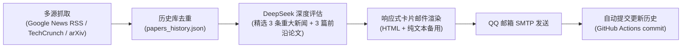

# 🚀 每日 AI & 设计前瞻日报 (AI & Design Intelligence Digest)

> 每天自动化追踪全球前沿人工智能与设计交叉领域的重大变革，由 **DeepSeek** 深度研读并精选：**3 条今日重大前瞻新闻** ＋ **3 篇前沿学术论文**，通过精美响应式邮件准时送达。

---

## 🌟 核心特色与日报结构

每日简报采用清晰专业的结构化排版（移动端/电脑端响应式卡片），围绕**前瞻性**与**行业颠覆价值**展开：

### 1. 🔥 今日重大 AI & 设计新闻 TOP 3（置顶）
- **中文精炼标题**：迅速把握今日全球最关键动态
- **事件核心概括**：2-3 句话厘清事实与技术要点
- **行业前瞻价值**：深度剖析该事件对**人工智能**、**设计行业**（创意生产力、空间计算、生成式工作流等）的深远变革与未来影响
- **🔗 原文报道直达链接**：邮件中提供显眼的「点击阅读完整新闻」交互按钮与完整 URL，一键直达官方或权威媒体报道。

### 2. 📚 精选前瞻学术论文 TOP 3
- **中文标题 & 原英文标题**
- **作者团队 & 发表日期**
- **🔗 双重论文直达链接**：提供「📄 查看论文主页 (arXiv)」与「📥 阅读/下载 PDF 原文」双按钮，方便读者随时在手机或电脑端一键研读全文。
- **核心研究主题**（如：生成式3D、空间交互、计算架构、多模态智能等）
- **一句话研究概括**：极简提炼核心技术方法
- **行业前瞻价值与启发**：剖析其对未来设计实践、AI 交叉学科的启发与应用价值

---

## ⏰ 自动运行时间

- **每日定时**：北京时间 **12:20**（UTC 04:20）
- **执行方式**：GitHub Actions 全自动化云端运行，零服务器成本，免运维。
- **手动触发**：支持在 GitHub Actions 页面随时点击 `Run workflow` 立即生成并发送。

---

## 🛠️ 技术流程



---

## 📁 核心文件结构

```
.
├── main.py                     # 主运行逻辑（新闻/论文检索、DeepSeek分析、邮件推送）
├── research_profile.json       # 关注领域、arXiv 分类、关键词与 RSS 源配置
├── papers_history.json         # 历史推送记录数据库（防止重复推送）
├── requirements.txt            # 项目依赖（轻量秒级安装）
├── .env.example                # 本地调试环境变量模版
├── .gitignore                  # Git 忽略配置
└── .github/
    └── workflows/
        └── send-daily.yml      # GitHub Actions 每日自动化执行工作流
```

---

## ⚙️ 部署与使用配置

### 1. 配置 GitHub Secrets (用于云端每日自动运行)

进入你的 GitHub 仓库 -> **Settings** -> **Secrets and variables** -> **Actions** -> 点击 **New repository secret**，添加以下环境变量：

| Secret 名称 | 是否必填 | 说明 | 示例 |
| :--- | :---: | :--- | :--- |
| `DEEPSEEK_API_KEY` | **必填** | DeepSeek API 密钥 | `sk-xxxxxx` |
| `DEEPSEEK_API_BASE` | 可选 | API 基础地址（默认官方地址） | `https://api.deepseek.com` |
| `DEEPSEEK_MODEL` | 可选 | 调用的模型名称（默认 `deepseek-chat`） | `deepseek-chat` |
| `SENDER` | **必填** | 发件人邮箱（通常为 QQ 邮箱） | `your_qq_number@qq.com` |
| `SENDER_PASSWORD` | **必填** | 邮箱 SMTP 授权码（QQ邮箱在设置->账户中开启生成） | `abcdefghijklmnop` |
| `RECEIVER` | **必填** | 主接收人邮箱 | `receiver@example.com` |
| `RECEIVER_2` | 可选 | 第二接收人邮箱（如需同时抄送其他人） | `another@example.com` |

---

### 2. 本地开发与测试运行

如果你想在本地直接测试或调试：

```bash
# 1. 安装轻量依赖
pip install -r requirements.txt

# 2. 复制环境变量模版并填入配置
cp .env.example .env
# 编辑 .env 文件填入你的 DEEPSEEK_API_KEY 与邮箱凭证

# 3. 运行测试
python main.py
```

> **提示**：如果本地没有配置发件邮箱，程序会自动进入预览模式，在控制台打印完整的排版内容，方便随时调试提示词。

---

### 3. 自定义关注偏好与关键词

直接编辑 [`research_profile.json`](./research_profile.json)：
- `focus_areas`：关注的技术与设计方向；
- `keywords`：候选筛选的核心关键词；
- `preferred_arxiv_categories`：arXiv 抓取分类（如 `cs.AI`, `cs.HC`, `cs.CV`, `cs.GR` 等）；
- `news_rss_feeds`：新闻抓取的新闻源与搜索词。

---

## 📜 许可证

MIT License
