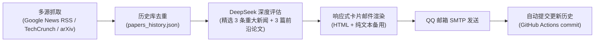

# 🚀 每日 AI & 设计前瞻日报 (AI & Design Intelligence Digest)

<p align="center">
  
  
  
  
</p>

> 每天自动化追踪全球人工智能与设计前沿交叉领域的重大突破，由 **DeepSeek** 深度研读并精选：**3 条今日重大前瞻新闻** ＋ **3 篇前沿学术论文**，通过精美响应式卡片邮件准时送达。
> 
> **无需自备服务器，GitHub Actions 每日定时运行，零成本、开箱即用！**

---

## 🌟 核心特色与日报结构

每日简报采用清晰专业的结构化排版（移动端/电脑端自适应卡片），围绕**前瞻性**与**行业颠覆价值**展开：

### 1. 🔥 今日重大 AI & 设计新闻 TOP 3（置顶）
- **极简中文标题**：15字以内迅速把握今日关键事件；
- **⚡ 一句话核心事实**：30-45字直奔主题，极简阐明重大动作；
- **💡 一句话前瞻启示**：25-35字一针见血点出对未来设计与 AI 行业的深远变革；
- **👉 全宽直达按钮**：每条均配备高对比度醒目按钮 **`👉 点击查看完整报道全文 →`**，引导读者点开深入阅读。

### 2. 📚 精选前瞻学术论文 TOP 3
- **精炼中英标题 & 领域标签**；
- **作者团队 & 发表日期**；
- **⚡ 一句话核心亮点**：30-45字极简阐明提出了什么新技术或攻克了什么痛点；
- **💡 一句话行业启发**：25-35字点出为什么值得设计与科技领域关注；
- **👉 双重直达按钮**：**`👉 查看论文主页 (arXiv) →`** 与 **`📥 PDF 原文`** 双按钮，方便读者一键研读全文。

---

## ⏰ 自动运行时间

- **每日定时**：北京时间 **12:20**（UTC 04:20）自动执行并推送。
- **手动触发**：支持在 GitHub Actions 页面随时点击 `Run workflow` 立即生成并发送。
- **历史防重**：自动对比历史推送库，确保每日内容绝不重复。

---

## 🛠️ 技术流程



---

## 🎁 3 分钟一键复制打造你的专属日报（小白保姆级指南）

如果你觉得这个项目很有趣，想为自己或团队搭建一个专属的每日 AI 与设计简报，只需按以下步骤操作，**3 分钟即可完全免费跑起来**！

### 步骤 1：一键 Fork 本项目
点击页面右上角的 **`Fork`** 按钮，直接将本项目复制一份到你自己的 GitHub 账号下。

---

### 步骤 2：开启 Actions 读写权限（⚠️ 重要必做）
GitHub 默认对 Fork 的仓库限制了写权限，请务必开启以保证历史记录能自动回写：
1. 进入你 Fork 后的仓库，点击顶部菜单的 **Settings**；
2. 在左侧边栏找到 **Actions** -> 点击 **General**；
3. 往下拉找到 **Workflow permissions**，将默认权限修改勾选为：
   👉 **`Read and write permissions`**（读写权限）；
4. 点击 **Save** 保存；
5. 点击仓库顶部的 **Actions** 标签页，如果页面显示绿色按钮 `"I understand my workflows, go ahead and enable them"`，点击开启。

---

### 步骤 3：配置 4 个专属 Secrets 密钥
进入仓库 **Settings** -> **Secrets and variables** -> **Actions** -> 点击 **New repository secret**，添加以下环境变量：

| Secret 变量名 | 是否必填 | 说明 | 获取方式教学 |
| :--- | :---: | :--- | :--- |
| `DEEPSEEK_API_KEY` | **必填** | DeepSeek API 密钥 | 访问 [DeepSeek 开放平台](https://platform.deepseek.com/) 注册并创建 API Key（成本极低，一个月不到几毛钱） |
| `SENDER` | **必填** | 发件人邮箱 | 你的发信 QQ 邮箱，例如 `12345678@qq.com` |
| `SENDER_PASSWORD` | **必填** | 邮箱 SMTP 授权码 | **注意：不是 QQ 密码！**<br>获取方法：电脑打开 [QQ 邮箱网页端](https://mail.qq.com/) -> 点击顶部「设置」->「账户」-> 下拉找到「POP3/IMAP/SMTP/Exchange/CardDAV/CalDAV服务」-> 开启「POP3/SMTP服务」，按提示发送短信即可拿到一串 **16 位英文授权码** |
| `RECEIVER` | **必填** | 接收简报的邮箱 | 接收日报的邮箱（自己的 QQ 邮箱、网易邮箱、Gmail 均可） |
| `RECEIVER_2` | 可选 | 第二位接收人邮箱 | （可选）如果你想同时抄送给搭档、导师或朋友 |
| `DEEPSEEK_MODEL` | 可选 | 调用的模型 | 默认 `deepseek-chat`，无需修改 |

---

### 步骤 4：一键手动测试，收第一封日报！
配置完成后，不需要等到中午 12:20，你可以立即测试：
1. 点击仓库顶部的 **Actions** 标签；
2. 在左侧选择 **`Daily AI & Design Intelligence Digest`** 工作流；
3. 点击右侧下拉按钮 **`Run workflow`** -> 点击绿色按钮 **`Run workflow`**；
4. 稍等约 20~30 秒，查看执行完成并打绿勾；
5. 打开你的收件箱，精美的今日 AI & 设计前瞻日报就已经躺在你的邮箱里啦！🎉

---

### 步骤 5：进阶玩法 —— 定制属于你的专属研究画像
如果你有独特的偏好（例如你更关注机器人、具身智能、纯 UI 设计或生信医疗）：
- **修改关注领域**：直接在线编辑仓库中的 [`research_profile.json`](./research_profile.json)，修改其中的 `keywords`、`focus_areas`、`preferred_arxiv_categories` 分类；
- **调整推送时间**：编辑 [`.github/workflows/send-daily.yml`](./.github/workflows/send-daily.yml) 中的 `cron: "20 4 * * *"`（这是 UTC 时间 04:20，即北京时间 12:20），你可以任意调整为你习惯阅读的时间。

---

## ❓ 常见问题 FAQ

> **Q1：GitHub Actions 运行报错 `Permission to ... denied to github-actions[bot]`？**  
> **A：** 这是因为步骤 2 中忘记勾选 `Read and write permissions`。请到仓库 Settings -> Actions -> General -> Workflow permissions 勾选后重新运行。

> **Q2：提示 `SMTPAuthenticationError` 或邮件发送失败？**  
> **A：** 请确保 `SENDER_PASSWORD` 填的是 QQ 邮箱生成的 **16 位 SMTP 授权码**，而不是你登录 QQ 的密码。

> **Q3：每天自动运行需要花钱吗？**  
> **A：** **完全免费！** GitHub Actions 对公开仓库提供每月 2000 分钟的免费执行额度。本项目经过依赖精简优化，每次运行仅需 20 秒左右，一个月仅消耗约 10 分钟额度；DeepSeek 每次 API 消耗不到 0.005 元，真正做到零服务器维护、永久免运维。

---

## 📁 项目文件清单

```
.
├── main.py                     # 核心业务逻辑（多源检索、候选筛选、DeepSeek研读、双模邮件渲染）
├── research_profile.json       # 研究画像与关注领域配置（支持自由定制）
├── papers_history.json         # 历史推送数据库（自动去重防重推）
├── requirements.txt            # 项目依赖（秒级安装，零臃肿）
├── .env.example                # 本地调试环境变量模版
├── .gitignore                  # Git 忽略配置
└── .github/
    └── workflows/
        └── send-daily.yml      # GitHub Actions 每日自动化执行工作流
```

---

## 📜 许可证

本项目基于 [MIT License](LICENSE) 开源，欢迎自由 Fork、修改与分享。如果你觉得好用，欢迎点一个 ⭐️ **Star** 支持一下！
